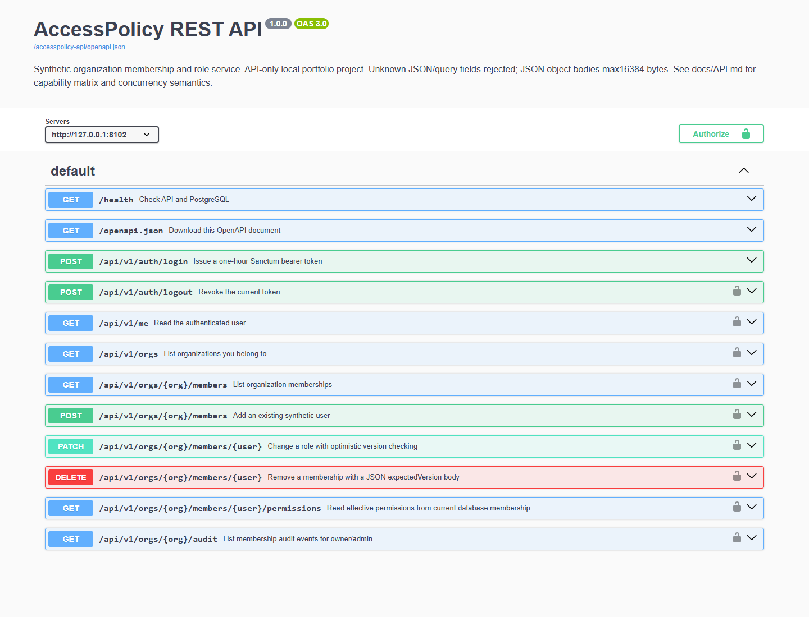

# AccessPolicy API

AccessPolicy manages organization memberships through a PHP REST API. A role change updates the membership, revokes every existing token owned by the affected user, and writes an audit event in one PostgreSQL transaction. An organization keeps at least one owner when concurrent requests try to demote its owners.

This repository contains a synthetic portfolio service, its PostgreSQL tests, OpenAPI contract, and runnable request examples. All four demo identities use `@accesspolicy.test` addresses. It sends no email and uses no external identity provider.



This image renders the committed OpenAPI contract with Swagger UI. It is API documentation, not a business dashboard or a recorded response from a running server.

## Stack

PHP 8.4, Laravel 12, Sanctum 4, PostgreSQL 17, Composer, Docker Compose, and PHPUnit. The Docker image provides the required PHP extensions. The PHP 8.1 installation in XAMPP is insufficient to run this application; Docker avoids changing that installation.

Laravel 12 is in security support until 24 February 2027. Dependency versions are locked in `composer.lock`; plan a framework upgrade before that date. See the [official support policy](https://laravel.com/framework/docs/12.x/releases#support-policy).

## Run locally on Windows

Install Docker Desktop with its Linux engine enabled, then open PowerShell in this repository:

```powershell
.\scripts\Init.ps1
.\scripts\Start.ps1
```

The first command generates an ignored `.env` and `.local/LOCAL-CREDENTIALS.txt`. Passwords and the application key are private random values. The second builds the PHP image, migrates PostgreSQL, seeds the demo once, and starts the API.

| Service | Local address |
| --- | --- |
| Health | `http://127.0.0.1:8102/health` |
| OpenAPI JSON | `http://127.0.0.1:8102/openapi.json` |
| REST API | `http://127.0.0.1:8102/api/v1` |
| PostgreSQL | `127.0.0.1:5458`, database/user `accesspolicy` |

The HTTP server and PostgreSQL port bind to loopback. The PHP built-in server is provided for local demonstrations. A public deployment needs a production HTTP server, TLS, secret management, and an appropriate login admission policy.

## Try the API

Import [the Postman collection](docs/postman.collection.json) and [the environment template](docs/postman.environment.example.json). Fill the password locally from `.local/LOCAL-CREDENTIALS.txt`; the committed environment contains blank secrets. Run requests 01 through 08 individually. Membership mutations are in a separate manual folder because they change the seed data.

For VS Code REST Client, use [smoke.http](docs/smoke.http). Read actual organization IDs, user IDs, and membership versions from the API before editing a membership.

```http
POST /api/v1/auth/login
Content-Type: application/json

{"email":"owner@accesspolicy.test","password":"YOUR_PRIVATE_LOCAL_PASSWORD"}
```

Login returns a bearer token once. Send `Authorization: Bearer <token>` to protected endpoints. Tokens expire after one hour. Organization rights come from the current database membership, rather than token abilities.

```http
PATCH /api/v1/orgs/1/members/3
Authorization: Bearer YOUR_LOCAL_TOKEN
Content-Type: application/json

{"role":"viewer","expectedVersion":1}
```

These IDs describe a fresh seed. The response includes the new version and `tokensRevoked`. An affected user must log in again, including when it was using its token in another organization. Repeating an old version returns `409 stale_version`.

## Roles and invariants

| Operation | Viewer / member | Admin | Owner |
| --- | --- | --- | --- |
| Read members and own permissions | Yes | Yes | Yes |
| Read another member's permissions or audit | No | Yes | Yes |
| Add/change/remove ordinary member or viewer | No | Yes | Yes |
| Assign or modify admin/owner | No | No | Yes |
| Modify own membership | No | No | Yes, subject to final-owner protection |

Atlas starts with two owners, an admin, and a member. Birch starts with one of those owners and the same member as viewer. This overlap demonstrates organization scoping and the explicit contract that membership edits revoke all of a target user's tokens globally.

Membership writers lock the organization row, lock affected user rows in ID order, recheck the bearer token, then validate the actor's current role and expected version. Token issuance locks the same user row. Concurrent owner demotions therefore serialize before checking the final owner count. A stale or revoked actor token cannot authorize a membership change using an earlier authentication result.

## Validate

```powershell
.\scripts\Test.ps1
node .\scripts\smoke.mjs
.\scripts\Stop.ps1
```

`Test.ps1` builds the test image and runs PHPUnit against a temporary **real PostgreSQL** database named `accesspolicy_test`, isolated on port 5459. It refuses an occupied test port and removes only its test stack afterward. The Node 22 smoke script exercises the running HTTP stack, changes the synthetic member to viewer and back, and writes a secret-free report to `.local/http-smoke.json`.

The authored tests cover tenant isolation, role escalation, token expiry/revocation, stale edits, atomic rollback on failure, and simultaneous owner demotions through two independent application processes. [VERIFICATION.md](docs/VERIFICATION.md) records what has actually run. A test's presence in source is not a passing result.

## Request boundaries

- JSON object bodies are limited to 16 KiB. Unknown body and query fields return 422. Malformed JSON returns 400; another content type returns 415.
- Missing/invalid authentication returns 401. Disallowed role actions return 403. An organization outside the caller's membership returns 404.
- Member and audit lists accept `limit=1..50` and an exclusive `afterId` cursor.
- The database persists one global login window: ten validly shaped attempts per 300 seconds, including successful logins. This local-demo limit ignores forwarded IP headers and survives application restarts. Read `Retry-After` before retrying.
- The service caps active tokens at 20 per user. Tokens/passwords are omitted from member and audit responses. Login is the only response that exposes a raw token.

## Reading the code

Start with [CODE-GUIDE.md](docs/CODE-GUIDE.md), an Indonesian walkthrough of the entry points, files, and transactional functions. [API.md](docs/API.md) defines the contract, [OPERATIONS.md](docs/OPERATIONS.md) covers recovery and database access, and [INTERVIEW.md](docs/INTERVIEW.md) gives a demonstration script with tradeoffs to discuss.

The repository does not implement public registration, password reset, email invitations, custom role creation, an OAuth server, or a graphical admin application.
